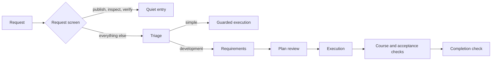

<p align="center">
  
</p>

<h1 align="center">Jevstice</h1>

<p align="center"><strong>Jev reviews the executor's decisions at OMP tool boundaries.</strong></p>

<p align="center">
  <a href="#install">Install</a> ·
  <a href="#tools">Tools</a> ·
  <a href="#how-it-works">How it works</a> ·
  <a href="#anti-slop-review">Anti-slop</a> ·
  <a href="#configuration">Configuration</a> ·
  <a href="#optional-autonomy">Autonomy</a> ·
  <a href="#development">Development</a>
</p>

<p align="center">
  
  <a href="LICENSE"></a>
  
  
</p>

Jevstice connects [oh-my-pi](https://github.com/can1357/oh-my-pi) to Jev (`jev-latest`, TypeSafe API), a decision judge. The executor submits the decisions it can see - requirements, plans, search results, acceptance claims and single uncertain choices - and receives a typed verdict before a consequential tool call executes.

The extension holds visible boundaries. It does not read private reasoning or run an OS sandbox. A refusal is explicit, a judge failure fails closed, and the owner can release the current request without turning a refusal into an approval.

> [!NOTE]
> Jevstice is an OMP extension, not a standalone CLI. The ordinary addon needs Bun 1.1 or newer, OMP and a TypeSafe API key. The optional autonomy module adds Linux-only prerequisites.

## Install

| Requirement | Detail |
| --- | --- |
| Runtime | Bun 1.1 or newer |
| Host | [oh-my-pi](https://github.com/can1357/oh-my-pi) |
| Judge key | `TYPESAFE_API_KEY`, `JEVI_API_KEY`, or a command in `TYPESAFE_API_KEY_COMMAND` |

### 1. Clone into the extension directory

```sh
git clone https://github.com/veschin/jevstice.git ~/.omp/agent/extensions/jevstice
```

OMP reads the manifest entry `src/index.ts` from `package.json`. Dependencies install on first run; run `bun install` in the checkout if your setup does not install them.

### 2. Provide the key

```sh
export TYPESAFE_API_KEY="..."
```

The extension can also resolve the key from a command when the judge is called:

```sh
export TYPESAFE_API_KEY_COMMAND='pass show token/jev'
```

The key is read lazily and passed only to the judge client. A missing key fails closed: the extension loads, and every judged activity reports an unusable answer.

### 3. Restart OMP

The host loads extension schemas and hooks at process start. Restart OMP after installing or updating the extension.

### Load a checkout explicitly

```sh
omp --no-extensions -e /path/to/jevstice/src/index.ts
```

This launches OMP with this checkout for one session and leaves the installation and launch settings unchanged.

> [!TIP]
> Run `/jev-status` in a session to see per-tool `ok` and `fail` counts, judge calls and spend.

## Tools

Jevstice registers ten tools. Each one asks a single question shape and returns typed details.

| Tool | Decision |
| --- | --- |
| `jev_triage` | Does this request need development planning, and which topics does it need? |
| `jev_search_relevance` | Which supplied search candidate is relevant, or is none of them? |
| `jev_requirements` | Does each requirement follow from the owner's request, and does the set cover it? |
| `jev_plan_review` | Does the outline, each plan section and the assembled plan serve the task? |
| `jev_consult` | One evidence-backed choice, score or boolean question. |
| `jev_acceptance` | Does the delivered work meet the business need and the architecture, judged separately? |
| `jev_review` | Does a checkpoint, commit or diff hold up as developer work? |
| `jev_reaim` | Is this an owner change of direction that replaces the current task? |
| `jev_text_review` | Which prose fragments violate the submitted rules, and which rule does each violate? |
| `jev_anti_slop` | Do the artifact's claims, inferences, hypotheses and language hold against quoted evidence? |

Three commands are registered alongside the tools:

| Command | Effect |
| --- | --- |
| `/jev-status` | Report current session calls, outcomes and spend. |
| `/jev-continue` | Release the current request across all gates with unresolved findings OPEN. |
| `/jev-waive <finding-id> <reason>` | Record one anti-slop finding as waived by the owner, not approved by Jev. |

A typical developed task runs through the same stages that the tools expose:



## How it works

### A free reading decides entry

`src/screen.ts` reads request text locally. A request that only publishes, inspects or verifies existing work is `quiet` and costs no judge call. Every other request, including unrecognised text, enters the judged workflow; triage then decides how deep it goes. The reading decides entry only. A development task already registered keeps its walls when a later request says "commit and push".

### Consequential calls are judged on the full payload

Read-only tools, task tracking and recognized inspection commands pass without an action judgment. Unknown tools, executable code, delegation, mutating devices and shell syntax with uncertain effects wait for triage and then for authorization against the owner's request. The action check receives the complete JSON payload; an oversized payload is refused rather than silently truncated.

### Refusals are bounded and visible

Repeated refused material costs no new judge call. Three refused submissions, three blocked calls at one boundary, or three availability failures release the current request with its findings recorded as OPEN. `/jev-continue` or a standalone approval message such as `аппрув`, `одобряю продолжение` or `approve continuation` releases it immediately. A release never manufactures a Jev approval.

> [!WARNING]
> Jevstice protects visible tool boundaries. It cannot authenticate submitted evidence and cannot detect every deceptive submission. Acceptance depends on the execution evidence and code evidence the executor supplies.

### Approvals bind to bytes and revisions

Plan approval binds to the exact artifact bytes. A changed plan invalidates acceptance and completion recorded against the previous plan. Successful and failed consequential mutations advance the work revision, so an earlier external review or acceptance cannot survive a later change.

## Anti-slop review

`jev_anti_slop` reviews an external document, research output or legal communication. It compares each factual claim with its quoted evidence and returns `supported`, `refuted` or `not_enough_info`. It re-checks conclusions against premises under a stated warrant, requires a falsifier for a hypothesis, and reports language, register and meta-text violations per fragment. A quote identical to the claim does not count as evidence.

The review binds to the task or quiet request, work revision, artifact digest, language, register and rules. Findings from changed supporting material are new findings, so an earlier waiver does not cover them.

| Mode | Behavior |
| --- | --- |
| `off` | No review. |
| `advisory` | Findings are reported; completion is not held. This is the shipped default. |
| `enforce` | Completion and external delivery wait until the current review covers every part with no unwaived blocker. |

The review checks submitted claims against submitted quotes. It cannot authenticate a source or prove a claim true. Its claim checks follow FEVER, SciFact and AVeriTeC; inference checks follow Toulmin; source strength follows GRADE; hypothesis checks follow Popper's falsifiability test.

## Configuration

The project file `<project>/.omp/jev.config.json` overrides the user file `~/.omp/agent/jev.config.json`.

| Key | Values | Default | Effect |
| --- | --- | --- | --- |
| `gates.mutation` | boolean | `true` | Hold consequential changes at the Jev boundaries. |
| `gates.completion` | boolean | `true` | Hold session completion until the checks pass or release. |
| `courseCheck.mode` | `interval`, `completion` | `completion` | Judge the course of developed work periodically or once at the end. |
| `courseCheck.interval` | integer >= 1 | `3` | Consequential actions between interval course checks. |
| `antiSlop.mode` | `off`, `advisory`, `enforce` | `advisory` | External-artifact review policy. |
| `billing.balance` | non-negative number | unset | Owner's TypeSafe balance snapshot in dollars. |
| `billing.inputCostPerMillion` | non-negative number | `0.042` | Input token price used for spend estimates. |
| `billing.outputCostPerMillion` | non-negative number | `0` | Output token price used for spend estimates. |

```json
{
  "gates": { "mutation": true, "completion": true },
  "courseCheck": { "mode": "completion", "interval": 3 },
  "antiSlop": { "mode": "advisory" },
  "billing": { "balance": 10, "inputCostPerMillion": 0.042, "outputCostPerMillion": 0 }
}
```

An invalid value keeps the value already in force and names the file, key and retained value. Unknown keys are ignored. The public TypeSafe API exposes no balance endpoint, so `billing.balance` is a configured snapshot, not a live account balance.

Every ten activity calls and on `/jev-status`, the addon reports per-tool counts, judge calls and `spend/balance`, for example `spend 0.0012/10$`.

## Optional autonomy

<details>
<summary><strong>Experimental strict supervisor for Linux</strong></summary>

The optional module runs one immutable objective through requirements, staged planning, implementation, verification and current-revision acceptance without owner-confirmation rounds. It keeps the authoritative checkpoint, exact local artifacts, judge context and invocation intents in a private SQLite ledger. The package manifest never loads it: `bun run autonomy` starts `autonomy/driver.ts`, which launches the supervised child with `autonomy/index.ts` as its extension entry.

Full autonomy acceptance remains open. Post-compaction completion and crash-effect reconciliation did not complete in real trials. A simple objective passed end to end, but the unresolved trials are not passing results.

Strict supervision requires Linux with cgroup v2, a working systemd user manager, Bun, OMP, an authenticated executor model and the TypeSafe key or resolver. The supervisor fences the recorded systemd scope before recovery or cancellation can establish containment. It does not install a service and does not promise a restart after its own process exits.

The owner places the objective and policy outside the writable project roots:

```json
{
  "roots": ["/srv/project"],
  "effects": ["project"],
  "maxJudgeCalls": 200,
  "maxExecutorCalls": 500,
  "maxRuntimeMs": 3600000,
  "maxContextBytes": 262144,
  "maxArtifactBytes": 1048576
}
```

All limits are required positive integers. `publication` is a separate effect that must be authorized in the initial policy.

```sh
bun run autonomy start --objective /srv/jev-control/objective.txt --policy /srv/jev-control/policy.json
bun run autonomy status
bun run autonomy resume --run RUN_ID
bun run autonomy stop --run RUN_ID --reason "operator stop"
```

Keep the starting terminal attached: a durable wait does not end the supervisor. The default store is `~/.omp/agent/jevstice/autonomy.sqlite`; `--store` selects another private local database outside every writable root. `start` and `resume` accept `--omp` and `--model`.

See [the autonomy reference](docs/autonomy.md) for the lifecycle, deployment limits and requirements FR-57 through FR-66, and [the smoke guide](tools/README.md#strict-autonomy-smoke) for the real-host scenarios.

</details>

## Development

```sh
bun install
bun test
bun run typecheck
```

The suite uses injected judges and never calls the live API. The observed baseline on 2026-11-02 is 486 tests, 2170 assertions and 16 files.

Live checks use the production judge and, in host mode, a real OMP process:

```sh
bun tools/live-smoke.ts direct --scenario workflow
bun tools/live-smoke.ts host --scenario workflow
```

The direct run needs the judge key. The host run also needs OMP and an authenticated model. [tools/README.md](tools/README.md) documents both modes and their evidence output.

[PRD.md](PRD.md) records the functional requirements and their sources. [AGENTS.md](AGENTS.md) records the repository conventions, architecture and test baseline.

## License

Jevstice is released under the [MIT license](LICENSE).
