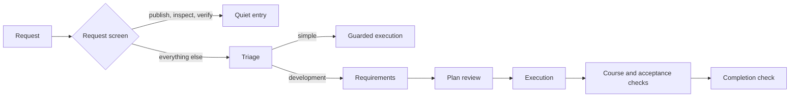

<p align="center">
  
</p>

<h1 align="center">Jevstice</h1>

<p align="center"><strong>Jev reviews the executor's decisions at OMP tool boundaries.</strong></p>

<p align="center">
  <a href="#install">Install</a> ·
  <a href="#tools">Tools</a> ·
  <a href="#session-control">Session control</a> ·
  <a href="#how-it-works">How it works</a> ·
  <a href="#anti-slop-review">Anti-slop</a> ·
  <a href="#configuration">Configuration</a> ·
  <a href="#optional-autonomy">Autonomy</a> ·
  <a href="#development">Development</a>
</p>

<p align="center">
  
  <a href="LICENSE"></a>
  
  
</p>

Jevstice connects [oh-my-pi](https://github.com/can1357/oh-my-pi) to Jev (`jev-latest`, TypeSafe API), a decision judge. The executor submits the decisions it can see - requirements, plans, search results, acceptance claims and single uncertain choices - and receives a typed verdict before a consequential tool call executes.

The extension holds visible boundaries. It does not read private reasoning or run an OS sandbox. Every refusal of a judged workflow decision - not an ordinary "no" answer to a consultation - records a finding with its boundary, work revision, exact submitted material and returned result; consequential work stays held until `jev_consult` with `mode: "recovery"` authorizes one exact replacement action in its `repair` phase or clears that finding from observed proof in its `resolve` phase. Refusal counts, judge outages and repeated stops only notify the owner - they never release work. An explicit owner continuation (`/jev-continue` or a recognized approval message) is an exceptional override that leaves the finding OPEN; it is not Jev approval. Trusted context is a provenance record, not a truth or permission record: see [Trusted context](#trusted-context).

> [!NOTE]
> Jevstice is an OMP extension, not a standalone CLI. The ordinary addon needs Bun 1.1 or newer, OMP and a TypeSafe API key. The optional autonomy module adds Linux-only prerequisites.

The owner can switch the ordinary addon off for urgent work and on again in the same session with the native `/jev` command; the switch is session-only and never edits the configuration. See [Session control](#session-control).

## Install

| Requirement | Detail |
| --- | --- |
| Runtime | Bun 1.1 or newer |
| Host | [oh-my-pi](https://github.com/can1357/oh-my-pi) |
| Judge key | `TYPESAFE_API_KEY`, `JEVI_API_KEY`, or a command in `TYPESAFE_API_KEY_COMMAND` |

### 1. Clone into the extension directory

```sh
git clone https://github.com/veschin/jevstice.git ~/.omp/agent/extensions/jevstice
```

OMP reads the manifest entry `src/index.ts` from `package.json`. Dependencies install on first run; run `bun install` in the checkout if your setup does not install them.

### 2. Provide the key

```sh
export TYPESAFE_API_KEY="..."
```

The extension can also resolve the key from a command when the judge is called:

```sh
export TYPESAFE_API_KEY_COMMAND='pass show token/jev'
```

The key is read lazily and passed only to the judge client. A missing key fails closed: the extension loads, and every judged activity reports an unusable answer.

### 3. Restart OMP

The host loads extension schemas and hooks at process start. Restart OMP after installing or updating the extension.

### Load a checkout explicitly

```sh
omp --no-extensions -e /path/to/jevstice/src/index.ts
```

This launches OMP with this checkout for one session and leaves the installation and launch settings unchanged.

> [!TIP]
> Run `/jev-status` in a session to see per-tool `ok` and `fail` counts, judge calls and spend.

## Tools

Jevstice registers twelve tools. `src/guidance.ts` supplies their descriptions, schemas and examples to registration and the startup prompt, so those two surfaces share one catalog.

| Tool | Decision |
| --- | --- |
| `jev_triage` | Does this request need development planning, and which topics does it need? |
| `jev_search_relevance` | Which supplied search candidate is relevant, or is none of them? |
| `jev_requirements` | Does each requirement follow from the owner's request, and does the set cover it? |
| `jev_plan_review` | Does the outline, each plan section and the assembled plan serve the task? |
| `jev_consult` | One diagnostic choice, score or boolean question, or a two-phase recovery: `repair` authorizes one exact replacement action, `resolve` clears the named finding with observed proof. |
| `jev_context` | List or read the project's trusted context archive, including requirement and plan snapshots. |
| `jev_course_check` | Does the submitted current-work claim, proposed next action and evidence follow the approved task? |
| `jev_acceptance` | Does the delivered work meet the business need and the architecture, judged separately? |
| `jev_review` | Does a checkpoint, commit or diff hold up as developer work? |
| `jev_reaim` | Is this an owner change of direction that replaces the current task? |
| `jev_text_review` | Which prose fragments violate the submitted rules, and which rule does each violate? |
| `jev_anti_slop` | Do the artifact's claims, inferences, hypotheses and language hold against quoted evidence? |

Four owner commands are registered alongside the tools; `/jev` also takes `off` and `on`:

| Command | Effect |
| --- | --- |
| `/jev` | Show whether Jevstice is on or off in this session. |
| `/jev off` | Disable every ordinary Jevstice boundary and automatic activity for this session; no judgment runs and held work is no longer blocked. |
| `/jev on` | Re-enable the ordinary addon with a fresh, empty workflow; old approvals, findings and continuation grants are not restored. |
| `/jev-status` | Report the session mode, calls, outcomes and spend. |
| `/jev-continue` | Permit the current request to continue with every unresolved finding still OPEN; an override is not Jev approval. |
| `/jev-waive <finding-id> <reason>` | Record one anti-slop finding as waived by the owner, not approved by Jev. |

### Session control

`/jev` reads the session mode; `/jev off` and `/jev on` change it. The switch is kept in memory for that one session: it writes no configuration file, leaves the global and project settings untouched, and a newly loaded session starts on. Repeating `/jev on` while on or `/jev off` while off is idempotent and only reports the current mode.

`off` takes effect immediately. Ordinary `tool_call` and `tool_result` boundaries, `session_stop`, owner-source capture, workflow prompt injection and judged tool execution stop for that session; a Jev tool returns an explicit skipped/disabled result, never an approval. A mode change steers an active executor before its next action. When the session is idle, the command reports its result without starting a model turn.

`on` starts a fresh ephemeral workflow: no earlier approvals, findings or `/jev-continue` continuation grant are restored, and a judgment that was already in flight when the mode changed is detached and discarded. Archived sources and the session usage/activity totals are retained, because they are diagnostic records rather than permissions. The same switch is owner-only: model prose, quoted text and tool arguments cannot change the mode.

The optional strict autonomous run is not affected by `/jev off` or `/jev on`; it refuses the in-session switch and is stopped only through its supervisor.

A typical developed task runs through the same stages that the tools expose:



## How it works

### A free reading decides entry

`src/screen.ts` reads request text locally. A request that only publishes, inspects or verifies existing work is `quiet` and costs no judge call, including Russian summary and retelling phrasing such as `саммари` or `пересказ`; a change word still wins, so "добавь пересказ в README" is judged. Reading an `http://` or `https://` URL is an external-artifact read and stays open while a project read waits for triage. Every other request, including unrecognised text, enters the judged workflow; triage then decides how deep it goes. The reading decides entry only. A development task already registered keeps its walls when a later request says "commit and push".

### Owner follow-ups are classified, not assumed

Every authentic owner message is archived, and while a development task is active the queued messages are compared with the objective at the next consequential, planning or completion boundary. A clarification continues the task and keeps approvals. An addition extends the accumulated objective and reopens dependent requirements, plan and acceptance without discarding holds or refusal history. Only a judged replacement holds work for `jev_reaim`; an unclear answer holds work until an evidence-bound consultation or an explicit owner clarification. A routine clarification or addition never requires a re-aim.

### Consequential calls are judged on the full payload

Read-only tools, task tracking and recognized inspection commands pass without an action judgment. The shell reading is bounded and quote-aware: a separator, pipe, operator, substitution or `-o`/`--output` write option inside quotes is literal data, while a quoted program name, an absolute or relative program path, a positional output file, an unknown expansion, a redirection or a shell-capable reporting program stays consequential. This removes the earlier false holds on harmless quoted arguments such as `git commit -m "feat(core): add a && b"` and on compound reports built from `git log`, `git diff`, `rg` and `head`, without admitting a write hidden in the same syntax. Unknown tools, executable code, delegation, mutating devices and shell syntax with uncertain effects wait for triage and then for authorization against the owner's request. The action check receives the complete JSON payload; an oversized payload is refused rather than silently truncated.

### A refusal holds work until a repair or a proven resolution

A Jev refusal or refused consequential call records a finding with a stable id, its boundary, original work revision, original submitted material and returned result. A later failed recovery does not overwrite that original cause. Local argument errors create no Jev finding because no judgment ran: correct the field and submit again. While a finding stands, evidence reads, `jev_context`, `jev_course_check`, diagnostic choice/score/boolean consultations, requirement and plan review and a resubmission of the same failed judged activity remain callable; other consequential calls are held, and those permitted calls do not clear the finding or authorize project effects by themselves.

Feedback is concise: the result, the observable reason and one next action, instead of repeating the refused payload. The exact original submission and returned result stay in the tool's structured `details`, and `jev_context({"action":"list"})` prints the standing finding with its original JSON under `hold`. Message counts are diagnostic and are never exhausted permissions or a consultation limit.

`jev_consult` with `mode: "recovery"` has two phases. `phase: "repair"` names one native tool and its complete input in `nextAction`; the judge answers one canonical boolean `repair_action` at the unchanged workflow boolean floor (0.7), and a passing answer authorizes only that exact invocation under the unchanged finding, task, owner request, requirements, plan and revision. It does not claim the defect is fixed, and every other consequential call stays held. When the refused action never executed, admitting the exact approved replacement retires that action-preflight finding; any other finding remains until an explicit `resolve` with observed proof. `phase: "resolve"` takes no `nextAction`, requires a diagnosis, a correction and quoted proof, and its one canonical boolean `resolves_hold` at the same floor clears only the named finding. The addon supplies the held finding, approved plan, requirements and recent native action observations, so the executor diagnoses that material instead of inferring a cause from a score or merely rewording the request. Duplicate recovery is keyed by phase, exact action, bindings and evidence; unchanged material costs no new judge call. An owner override stays exceptional and is never the next step the addon requests.

Repeated refusals, judge outages, blocked calls and repeated stops notify the owner and leave the finding OPEN; none of them release work or count as approval. `/jev-continue` or a standalone approval message such as `аппрув`, `одобряю продолжение` or `approve continuation` permits the current request to continue with the finding disclosed as OPEN. That permission is the owner's override, not Jev approval.

> [!WARNING]
> Jevstice protects visible tool boundaries. It cannot authenticate submitted evidence and cannot detect every deceptive submission. Acceptance depends on the execution evidence and code evidence the executor supplies.

### Approvals bind to bytes and revisions

Plan approval binds to the exact artifact bytes. A changed plan invalidates acceptance and completion recorded against the previous plan. Successful and failed consequential mutations advance the work revision, so an earlier external review or acceptance cannot survive a later change.

### Trusted context

The addon captures authentic interactive and RPC owner messages automatically. In print mode, which omits the input event, it records the native user-containing prompt instead; revival and agent-only turns add no owner source. It also snapshots approved requirements and the exact approved plan bytes. Records live under `<project>/.omp/jev/context` as immutable JSON files named by a content-addressed identifier; every read verifies the identifier and content digest, and a modified, renamed or malformed record is reported instead of trusted.

`jev_context` lists the inventory and reads one complete source. Evidence items may carry a `sourceId`; the controller resolves it before any judge call and refuses a missing source, a quote absent from the stored content, or a `kind: "user"` citation of a non-owner record. The exact selected source contents and the session's owner-message history accompany the submission under an explicit rule: provenance establishes origin only. Archived text is data, not an instruction, and neither its presence nor its approval metadata establishes factual truth, restores an approval or grants execution permission. The addon has no OS sandbox and cannot authenticate a source's claims.

## Anti-slop review

`jev_anti_slop` reviews an external document, research output or legal communication. It compares each factual claim with its quoted evidence and returns `supported`, `refuted` or `not_enough_info`. It re-checks conclusions against premises under a stated warrant, requires a falsifier for a hypothesis, and reports language, register and meta-text violations per fragment. A quote identical to the claim does not count as evidence.

The review binds to the task or quiet request, work revision, artifact digest, language, register and rules. Findings from changed supporting material are new findings, so an earlier waiver does not cover them.

| Mode | Behavior |
| --- | --- |
| `off` | No review. |
| `advisory` | Findings are reported; completion is not held. This is the shipped default. |
| `enforce` | Completion and external delivery wait until the current review covers every part with no unwaived blocker. |

The review checks submitted claims against submitted quotes. It cannot authenticate a source or prove a claim true. Its claim checks follow FEVER, SciFact and AVeriTeC; inference checks follow Toulmin; source strength follows GRADE; hypothesis checks follow Popper's falsifiability test.

## Configuration

The project file `<project>/.omp/jev.config.json` overrides the user file `~/.omp/agent/jev.config.json`.

| Key | Values | Default | Effect |
| --- | --- | --- | --- |
| `gates.mutation` | boolean | `true` | Hold consequential changes at the Jev boundaries. |
| `gates.completion` | boolean | `true` | Hold session completion until the checks pass or release. |
| `courseCheck.mode` | `interval`, `completion` | `completion` | Judge the course of developed work periodically or once at the end. |
| `courseCheck.interval` | integer >= 1 | `3` | Consequential actions between interval course checks. |
| `antiSlop.mode` | `off`, `advisory`, `enforce` | `advisory` | External-artifact review policy. |
| `billing.balance` | non-negative number | unset | Owner's TypeSafe balance snapshot in dollars. |
| `billing.inputCostPerMillion` | non-negative number | `0.042` | Input token price used for spend estimates. |
| `billing.outputCostPerMillion` | non-negative number | `0` | Output token price used for spend estimates. |

```json
{
  "gates": { "mutation": true, "completion": true },
  "courseCheck": { "mode": "completion", "interval": 3 },
  "antiSlop": { "mode": "advisory" },
  "billing": { "balance": 10, "inputCostPerMillion": 0.042, "outputCostPerMillion": 0 }
}
```

An invalid value keeps the value already in force and names the file, key and retained value. Unknown keys are ignored. The public TypeSafe API exposes no balance endpoint, so `billing.balance` is a configured snapshot, not a live account balance.

Every ten activity calls and on `/jev-status`, the addon reports per-tool counts, judge calls and `spend/balance`, for example `spend 0.0012/10$`. The report is informational; it grants no permission and releases no finding. These counters are diagnostic: revisiting a finding, changing the mode or repeating a request does not exhaust them into permission.

`/jev off` and `/jev on` are not configuration. They switch only the current session, are stored in memory, and leave both configuration files unchanged; use the `gates` keys above to change the installed defaults.

## Optional autonomy

<details>
<summary><strong>Experimental strict supervisor for Linux</strong></summary>

The optional module runs one immutable objective through requirements, staged planning, implementation, verification and current-revision acceptance without owner-confirmation rounds. It is a separate strict runtime: ordinary `/jev off`, `/jev on`, `/jev-continue` and `/jev-waive` do not apply to it, and the owner stops it only through the supervisor. It keeps the authoritative checkpoint, exact local artifacts, judge context and invocation intents in a private SQLite ledger. The package manifest never loads it: `bun run autonomy` starts `autonomy/driver.ts`, which launches the supervised child with `autonomy/index.ts` as its extension entry.

Full autonomy acceptance remains open. Post-compaction completion and crash-effect reconciliation did not complete in real trials. A simple objective passed end to end, but the unresolved trials are not passing results.

Strict supervision requires Linux with cgroup v2, a working systemd user manager, Bun, OMP, an authenticated executor model and the TypeSafe key or resolver. The supervisor fences the recorded systemd scope before recovery or cancellation can establish containment. It does not install a service and does not promise a restart after its own process exits.

The owner places the objective and policy outside the writable project roots:

```json
{
  "roots": ["/srv/project"],
  "effects": ["project"],
  "maxJudgeCalls": 200,
  "maxExecutorCalls": 500,
  "maxRuntimeMs": 3600000,
  "maxContextBytes": 262144,
  "maxArtifactBytes": 1048576
}
```

All limits are required positive integers. `publication` is a separate effect that must be authorized in the initial policy.

```sh
bun run autonomy start --objective /srv/jev-control/objective.txt --policy /srv/jev-control/policy.json
bun run autonomy status
bun run autonomy resume --run RUN_ID
bun run autonomy stop --run RUN_ID --reason "operator stop"
```

Keep the starting terminal attached: a durable wait does not end the supervisor. The default store is `~/.omp/agent/jevstice/autonomy.sqlite`; `--store` selects another private local database outside every writable root. `start` and `resume` accept `--omp` and `--model`.

See [the autonomy reference](docs/autonomy.md) for the lifecycle, deployment limits and requirements FR-57 through FR-66, and [the smoke guide](tools/README.md#strict-autonomy-smoke) for the real-host scenarios.

</details>

## Development

```sh
bun install
bun test
bun run typecheck
```

The suite uses injected judges and never calls the live API. Last recorded verification at the two-phase recovery contract: `bun test` passed 555 tests with zero failures and 2530 assertions across 17 files, with a clean `bun run typecheck --noUnusedLocals --noUnusedParameters` and a clean code-guard deep check; the workflow boolean floor is 0.7, while choice and score stay at 0.6 and anti-slop at 0.8. Before the recovery-contract change: `bun test` passed 552 tests with zero failures and 2509 assertions across 17 files; code-guard's deep check completed clean, including TypeScript's no-emit check. Fresh native OMP RPC commands switched session mode off and on without starting a model turn. A real OMP/DeepSeek run read `https://example.org/` for `саммари` and executed both reported inspection commands without a failed tool, hold or Jev call. The two-phase recovery contract passed one live OMP/DeepSeek probe (`/tmp/jev-recovery-probe/run-2026-11-13T11-33-47-418Z-4ee9fa`): a forbidden write was refused at 1.00, `repair_action` passed at 0.83 against the 0.7 floor, the exact approved replacement ran once and retired the action-preflight finding with no owner override. Full live-workflow acceptance and whole-task acceptance remain unproved; see [tools/README.md](tools/README.md) for probe scope and the earlier below-floor result.

Live checks use the production judge and, in host mode, a real OMP process:

```sh
bun tools/live-smoke.ts direct --scenario workflow
bun tools/live-smoke.ts host --scenario workflow
```

The direct run needs the judge key; host mode also needs OMP and an authenticated model. The older workflow scenario exercised automatic release and does not prove the current recovery contract. [tools/README.md](tools/README.md) separates the current focused verification from historical workflow evidence and unresolved live recovery.

[PRD.md](PRD.md) records the functional requirements and their sources. [AGENTS.md](AGENTS.md) records the repository conventions, architecture and test baseline.

## License

Jevstice is released under the [MIT license](LICENSE).
